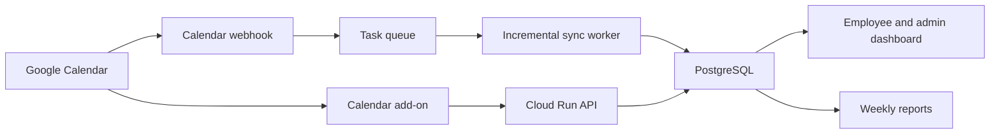

# Calendar App: Google-First Development Plan

The recommended Google-first MVP is a web application plus a Google Calendar add-on. It should calculate meeting credits, maintain team budgets, show contextual prompts, and produce weekly savings reports—without reading email or storing meeting titles or descriptions.

A two-engineer team could reach pilots in roughly 10–12 weeks. A solo developer should expect 14–18 weeks.

## Product scope

The first release should let a company:

- Connect employee Google Calendars.
- Assign weekly credits to teams.
- Calculate proposed and actual meeting consumption.
- Show the credit cost inside Google Calendar.
- Suggest shorter meetings or fewer attendees.
- Track recurring-meeting commitments.
- Send private individual and aggregated team reports.
- Run a free pilot before purchasing.

Example:

```text
Credits = meeting minutes ÷ 30 × internal participants
```

A 45-minute meeting with six internal participants costs nine credits.

The organizer’s team pays the credits. Meetings organized by outsiders are reported as “externally initiated meeting load” but do not consume the organizer budget.

## Architecture



Recommended stack:

- TypeScript monorepo
- Next.js web dashboard
- Node.js API and background workers
- Google Cloud Run
- Cloud SQL for PostgreSQL
- Cloud Tasks for calendar synchronization
- Cloud Scheduler for webhook renewal and reports
- Secret Manager and Cloud KMS
- Stripe after pilots validate willingness to pay

Google supports Workspace add-ons backed by ordinary HTTPS endpoints and specifically recommends Cloud Run for this model. See [Google HTTP add-ons](https://developers.google.com/workspace/add-ons/guides/alternate-runtimes).

## 12-week development plan

### Week 1: Validate the operating rules

Interview 8–10 people across operations, People, engineering management, and individual contributors. Recruit three design-partner companies.

Decide:

- Who receives budgets: individuals, departments, or both?
- Who pays when multiple departments attend?
- Which meetings are exempt?
- Whether an organizer can override a warning.
- Who may see individual versus aggregated information.
- What constitutes a successful pilot.

Deliverables:

- Written credit policy
- Clickable scheduling mockup
- Three pilot commitments
- Privacy and data-retention promises

### Weeks 2–3: Application foundation

Build:

- Google OAuth login
- Organization, team, and membership management
- Calendar connection flow
- Basic employee dashboard
- Credit calculator and policy engine
- Encrypted OAuth-token storage
- Audit logging
- Development and production environments

Start Google OAuth verification immediately. Public apps using calendar-data scopes can require verification, and marketplace publication also undergoes review.

- [Google Calendar scopes](https://developers.google.com/workspace/calendar/api/auth)
- [Google Workspace Marketplace publishing](https://developers.google.com/workspace/marketplace/how-to-publish)

### Weeks 4–5: Calendar synchronization and ledger

Implement:

- Initial synchronization of the previous 28 days and next 90 days
- Incremental synchronization using sync tokens
- Calendar push-notification webhook
- Notification-channel renewal
- Idempotent event processing
- Meeting creation, update, and cancellation handling
- Recurring-series expansion
- Attendee response changes
- Credit charges, adjustments, and refunds

Google’s webhook only signals that something changed; the worker must subsequently retrieve the changed events. Notification channels have limited lifetimes, so renewal must be automated.

- [Google Calendar push notifications](https://developers.google.com/workspace/calendar/api/guides/push)
- [Incremental synchronization](https://developers.google.com/workspace/calendar/api/guides/sync)

Credit rules for the MVP:

- Count the organizer and invited internal attendees when scheduling.
- Recalculate realized credits using accepted internal attendees.
- Exclude declined attendees, rooms, and resource calendars.
- Exclude cancelled, all-day, focus-time, and out-of-office events.
- Track external attendees, but do not charge credits for their time.
- Charge recurring events per occurrence while displaying projected quarterly and annual commitments.
- Refund cancelled future occurrences.

### Weeks 6–7: Google Calendar experience

Build a Google Calendar add-on that displays:

- Meeting credit cost
- Team budget remaining
- Quarterly cost of recurring meetings
- Number of internal participants
- Suggestions to shorten or reduce attendance
- Override reason when policy permits
- Link to the full dashboard

Google Calendar supports event-open triggers and an event-update trigger that runs before certain event changes are saved. However, the update trigger is limited mainly to attendee and conferencing changes; it is not a universal interception point for every native Calendar edit. See [Calendar add-on interfaces](https://developers.google.com/workspace/add-ons/calendar/building-calendar-interfaces).

Therefore:

- Use the add-on for contextual guidance.
- Use the Calendar API as the authoritative post-save ledger.
- Do not promise that every invite can be hard-blocked before creation.
- Test a Chrome extension later if fully live, pre-save enforcement proves essential.

Hard blocking should not be part of the MVP. Warnings and overrides will produce better behavioral data and less employee resistance.

### Weeks 8–9: Team administration and freemium

Add:

- Department and team setup
- Weekly budget configuration
- Exemption policies
- Budget resets and carryover settings
- Invitations for teammates
- Aggregated admin reporting
- A 30-day team pilot
- Free-versus-paid entitlements
- Data export and account deletion

Suggested packaging:

- **Free individual:** One calendar, personal budget, and weekly report
- **Free team:** Up to five connected employees
- **Pilot:** Full product for 30 days
- **Paid:** Approximately $4 per active employee per month, with a $99 minimum
- **Enterprise:** SSO, SCIM, HRIS integration, audit controls, and custom retention

Avoid building complicated billing until at least one pilot customer confirms the proposed price.

### Weeks 10–11: Pilots and security hardening

Onboard three companies with 20–100 employees each.

Complete:

- Privacy policy and terms
- Data-processing agreement
- Token encryption and rotation
- Rate limiting
- Webhook validation
- Tenant-isolation tests
- Automated data deletion
- Backup and recovery tests
- Error monitoring
- Synchronization reconciliation reports

Use the narrowest practical permissions. For organization-wide analytics, the app will likely need read-only calendar-event access. Avoid write access initially; suggestions can open Google Calendar for the employee to make the change.

Store only:

- Provider event identifier
- Organizer identifier
- Start and end times
- Recurrence identifier
- Internal and external attendee counts
- Response status
- Calculated credits
- Cancellation status

Do not store titles, descriptions, attachments, conferencing URLs, or guest notes.

### Week 12: Marketplace submission and commercial launch

Prepare:

- Google Workspace Marketplace listing
- Installation and uninstall documentation
- Admin deployment guide
- Security overview
- Demo workspace
- Pilot case-study template
- Pricing page
- Support and incident-response process

Public Marketplace applications are reviewed by Google. Private applications can be used within a design partner’s Workspace organization sooner, making private pilot deployments useful while public review proceeds. See [Marketplace publishing](https://developers.google.com/workspace/marketplace/how-to-publish).

## Core data model

Minimum entities:

- `organizations`
- `teams`
- `users`
- `memberships`
- `calendar_connections`
- `calendar_sync_channels`
- `events`
- `event_participants`
- `credit_policies`
- `credit_budgets`
- `credit_ledger_entries`
- `overrides`
- `recommendations`
- `weekly_reports`
- `subscriptions`
- `audit_events`

Make the credit ledger append-only. When a meeting changes, create an adjustment entry rather than rewriting history. This simplifies audits, refunds, and debugging.

## Pilot success metrics

The principal outcome metric should be:

> Internal meeting credits per connected employee per week, compared with the pre-pilot baseline.

Also measure:

- Percentage of costly meetings shortened or modified
- Recurring credits eliminated
- Internal meeting-hours per employee
- Meetings with more than eight attendees
- Organizer override rate
- Weekly-report open rate
- Employee-reported collaboration quality
- Pilot-to-paid conversion

A promising pilot result would be:

- 10% or greater reduction in internal meeting-hours
- 15% or greater reduction in projected recurring-meeting credits
- No meaningful decline in perceived collaboration
- At least one of three design partners converting to paid

## Explicitly postpone

Keep these out of the first release:

- Outlook and Microsoft Graph
- Gmail message access
- Salary-based dollar calculations
- AI transcription or meeting summaries
- Public employee leaderboards
- Blocking all over-budget meetings
- Calendly and HubSpot integrations
- HRIS and SSO
- Mobile applications
- Complex interdepartmental credit transfers

Once the Google pilot demonstrates behavior change and willingness to pay, Outlook becomes the next major development phase. The policy engine, ledger, reporting, and billing should all remain calendar-provider-neutral so only the authentication, event normalization, synchronization, and add-in layers require Microsoft-specific implementations.
